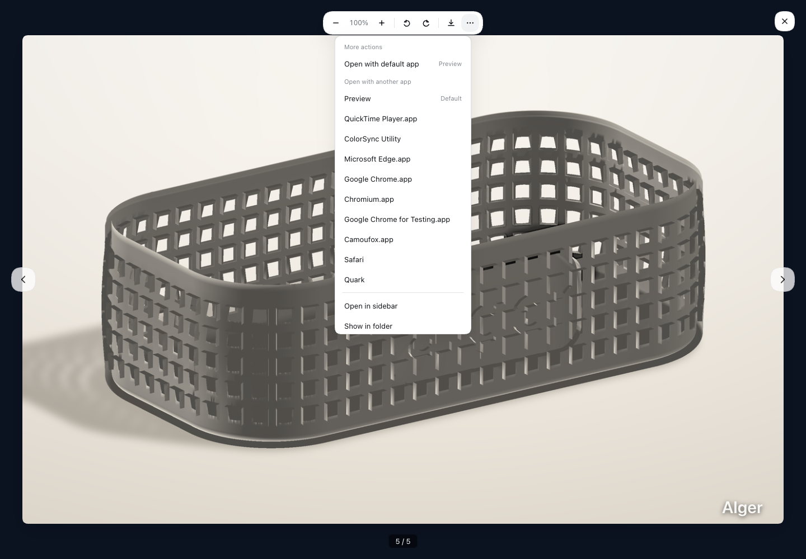

# dsh-image-preview

> [中文版](./README.zh.md)

**Image preview for the dsh session interface.** dsh 0.2.x already renders `read_image` as a collapsed image card and assistant final-output images as an official gallery. This plugin takes over all of them: `read_image` rows get a **thumbnail visible by default**, and images the user sends, plus images in the assistant's final answer — including image files in `present` delivery cards — use the same **full-size lightbox** with cross-image navigation, zoom, rotate, pan, download, and file actions (open with default/associated app, open in sidebar, reveal in folder).

## Features

| | |
| --- | --- |
| 🖼️ **Visible thumbnail** | `read_image` results render as a rounded ~240px thumbnail instead of a collapsed card, so the image is visible without expanding the row |
| 🔍 **Click for full size** | Click the thumbnail to open the original image in a lightbox — dismiss with `Esc`, clicking the backdrop, or the close button; focus is restored to the trigger on close |
| ↔️ **Cross-row navigation** | Arrow buttons / ← → keys cycle through **every image loaded in the session** (counter shows `3 / 4`) — dsh's built-in lightbox only ever shows a single image |
| 🔎 **Zoom, rotate, pan** | Toolbar with zoom out / zoom in / rotate left / rotate right / download. Scroll wheel zooms, drag pans while magnified, and `+` `-` `0` `,` `.` are keyboard shortcuts. Zoom is clamped to 25%–800% and resets when you switch images |
| ⬇️ **Download** | Saves the original bytes under the attachment's own filename through a same-origin `<a download>` (works with the `blob:` URLs the host loader returns) |
| 🔐 **Uses the host's image pipeline** | Image bytes are resolved through the session-authorized `loadImage` loader dsh injects into the slot owner — no hand-rolled attachment RPC |
| 🧾 **Final-output images** | Assistant image blocks (`conversation.chat.message.images`) and Markdown images in the final answer open the plugin lightbox too |
| 👤 **User-sent images** | Images in the user's own message (`conversation.chat.user.images`) are taken over too and open the plugin lightbox |
| 📂 **Presented image cards** | Image files in `present` delivery cards (e.g. `preview_hero.png`) open the plugin lightbox directly instead of the sidebar first; STL / Markdown cards keep the official preview |
| 🧩 **0.2.x-aware** | Shadows only the row renderer; the official `tool.call.images` child slot stays declared and untouched |
| ⏱️ **Complete states** | Running (`row.running`), failed with retry (`image.loadFailed`), and loading (`image.loading`) states are all covered |
| 🌗 **Theme aware** | All colors reference dsh theme tokens (`--dsw-*`), so the preview follows the light/dark theme automatically |

### Lightbox controls

| Action | Control | Shortcut |
| --- | --- | --- |
| Zoom in / out | toolbar `+` / `−`, or scroll wheel | `+` / `-` |
| Reset view | click the zoom percentage | `0` |
| Rotate | toolbar ↺ / ↻ | `,` / `.` |
| Pan | drag (only while magnified) | — |
| Download | toolbar ⤓ | — |
| More actions | toolbar ⋯ | — |
| Previous / next image | side arrows | `←` / `→` |
| Close | ✕, backdrop, or `Esc` | `Esc` |

## Compatibility

Built and verified against **dsh `0.2.1-rc.2`**. The browser contract is unchanged from `0.1.5-rc.2`; the plugin is still a pure client bundle with no host-side behavior. The manifest declares `engines.dsh: >=0.1.5-rc.2 <0.3.0-0` so dsh can reject it outside that range.

**What changed in dsh 0.2.x.** dsh now ships its own `read_image` toolview, image card, and `tool.call.images` child slot filled by the official `MessageImages` gallery. The official row is **collapsed by default**, and its lightbox shows one image at a time. This plugin still shadows the whole row so thumbnails stay visible, and keeps the extra lightbox features. It deliberately does **not** declare `tool.call.images` as a child: the official entry already declares that slot, and a second declaration would throw `slot ... is already declared`.

Image positions include the user message slot `conversation.chat.user.images` (official `MessageImages` at priority 100, shadowed at -1) and the assistant final-output paths. Assistant image blocks go through the `conversation.chat.message.images` single slot, which this plugin shadows at `priority: -1` (the official `MessageImages` uses `priority: 100`). Markdown images (``) are rendered by a private button/lightbox inside `MarkdownText`, not a slot, so the plugin intercepts clicks in the capture phase and opens its own lightbox. `present` delivery cards are not a slot either: the whole-card preview button's `title` is the Host absolute path, and the plugin intercepts only image extensions; STL / Markdown cards still open the official sidebar preview. If the host does not expose a ReactDOM render root, all interception backs off and leaves the official behavior intact.

`read_image` submits **PNG / JPEG / WebP / GIF** only, so those are the formats the plugin can display; earlier claims about SVG / BMP / ICO were incorrect.

> **Why the low priority matters.** `tool.call.toolview` is a **keyed** slot, and its registry rejects a second registration for the same key at the same priority:
>
> ```
> keyed slot "tool.call.toolview" already has an entry for key "read_image"
> at priority 0 — register at a different priority to shadow it (lowest renders)
> ```
>
> So this plugin registers at **`priority: -1`** to take over the shipped row. Without that, `apply()` throws during client boot and **not a single row renders** — which is exactly what happened before this fix.

## Preview

**Plugin lightbox** — a real session screenshot: click an image to open the plugin lightbox with cross-image navigation, zoom, rotate, pan, and download:


**File actions for presented images** — a real session screenshot: the ⋯ menu at the right of the toolbar offers the default app / associated apps / open in sidebar / reveal in folder:



> Screenshots by Alger.

## How it works

`dsh-image-preview` is a **pure client-side plugin**. It registers a keyed slot on `tool.call.toolview` with key `read_image` at `priority: -1` and takes over rendering of the `read_image` tool row:

```
agent runs read_image
  └─ tool result content: [{ text envelope }, { type: "image", attachment }]
       └─ tool-call node → tool.call.toolview (key = read_image, priority -1 shadows the shipped row)
            └─ ReadImageRow: thumbnail + click to open the cross-row Lightbox
```

- `sessionId` and `t` are injected by the session-scoped slot's standard kit (`dsh-client-ui-session` / the locale seat).
- `loadImage` is the session-authorized loader dsh passes in the slot owner props (`MessageImageLoader`, i.e. `uiConversation.imageUrl(sessionId, attachment)`, cached per session). The plugin never touches `/api/session.attachment` directly.
- Attachment metadata (`attachmentId`, `mediaType`, `width`, `height`) comes straight from the tool result block.
- The lightbox looks like dsh's built-in `ImageLightbox` (portal to `body`, backdrop mask, ESC/backdrop/close dismissal, focus restore) but adds cross-image navigation plus zoom / rotate / pan / download.
- Zoom and rotation are a single CSS `transform` on the `` (no re-encoding); downloads hand the loader's `blob:` URL straight to `<a download>`, so no bytes are copied or re-fetched.
- The image registry is bucketed by `sessionId`, so two sessions open at once never cross-navigate into each other's images.

Final-output images:

```
user message → conversation.chat.user.images (single slot, priority -1 shadows MessageImages)
assistant content
  ├─ image block → conversation.chat.message.images (single slot, priority -1 shadows MessageImages)
  │    └─ MessageImagesRow: thumbnail + click to open the same Lightbox
  ├─ Markdown  → private MarkdownText button
  │    └─ document click capture → plugin Lightbox (standalone React root)
  └─ present delivery image → [data-presented-file] > button[title] (Host absolute path)
       └─ document click capture → plugin Lightbox (standalone React root)
```

The `⋯` menu at the right edge of the lightbox toolbar offers local-file actions for images with a host path: open with the default application, choose from associated applications, open in the right sidebar, or reveal in the file manager. It uses dsh's Session Remote (`openWorkspacePath` / `workspacePathApplications`) and `sidebarRight.openResource`; the Host revalidates the path before launching anything.

## Installation

dsh 0.2.x uses separate profiles for the desktop app and the CLI web surface. Pick the one you actually run:

- **Desktop app:** `~/.dsh/profiles/desktop` (reserved for the app).
- **CLI web:** `~/.dsh/profiles/web`.

### Desktop app

Open the in-app **Plugins** page (sidebar) and install `algerkong/dsh-image-preview` from GitHub, then enable the bundle and restart the app. Alternatively, fully quit the app first (the profile is locked while it runs) and use the CLI:

```sh
dsh plugin --profile desktop add 'github:algerkong/dsh-image-preview'
```

`add` only installs the dependency. Enable the bundle in the Plugins page, or append `"@alger-ai/dsh-image-preview"` to `dsh.profile.bundles` in `~/.dsh/profiles/desktop/package.json`, then restart the app and refresh.

### CLI web

```sh
dsh plugin --profile web add 'github:algerkong/dsh-image-preview'
```

Then append the package to the existing `dsh.profile.bundles` array in `~/.dsh/profiles/web/package.json` (keep the bundles already listed):

```json
{
  "dsh": {
    "profile": {
      "bundles": [
        "@deepseek-ai/dsh-base",
        "@deepseek-ai/dsh-web-app",
        "@alger-ai/dsh-image-preview"
      ]
    }
  }
}
```

Run `pnpm install` in the profile, restart `dsh web`, and refresh the page.

### Manual install

Add the dependency to the profile's `package.json`:

```json
{
  "dependencies": {
    "@alger-ai/dsh-image-preview": "github:algerkong/dsh-image-preview"
  }
}
```

Then add `"@alger-ai/dsh-image-preview"` to `dsh.profile.bundles`, run `pnpm install`, and restart the surface.

### Local development

Link the package directly:

```sh
cd ~/.dsh/profiles/desktop   # or ~/.dsh/profiles/web
pnpm add link:/path/to/dsh-image-preview
```

Add `"@alger-ai/dsh-image-preview"` to `dsh.profile.bundles`, restart, and refresh.

## Usage

1. Start a session and let the agent call `read_image` on an image file.
2. The tool row shows a small thumbnail by default (the official row would stay collapsed).
3. Click the thumbnail to inspect the full-size original in the lightbox.

## Development

```sh
pnpm install
pnpm test        # node verify.mjs
```

`verify.mjs` checks three layers: the `__ModuleLoader__.load` registration shape, the **keyed-slot takeover contract** (it reproduces dsh 0.2.1-rc.2's keyed + `children` declaration rules and fails if the plugin forgets `priority: -1` or re-declares `tool.call.images`), and an actual render pass over the component (loadImage path, thumbnail, lightbox, Esc, multi-image grid and navigation, plus the zoom / rotate / download toolbar).

The self-check resolves React from the repo devDependency, then from `DSH_REACT_PATH` or a DSH profile. Missing React is an error; set `DSH_VERIFY_ALLOW_SKIP=1` only when you intentionally want to run the first two layers alone.

## Files

```
dsh-image-preview/
├── package.json        # bundle metadata (dsh.bundle.patch / dsh.client platform=web)
├── pnpm-lock.yaml      # devDependency lock (self-check only; not part of the bundle)
├── cordis.patch.yml    # registers the client entry (id: ui-image-preview)
├── lib/
│   ├── index.js        # host-side entry (empty — browser-only plugin)
│   └── client.js       # browser: read_image row + final-output images + lightbox
└── verify.mjs          # self-check script
```

## License

MIT
