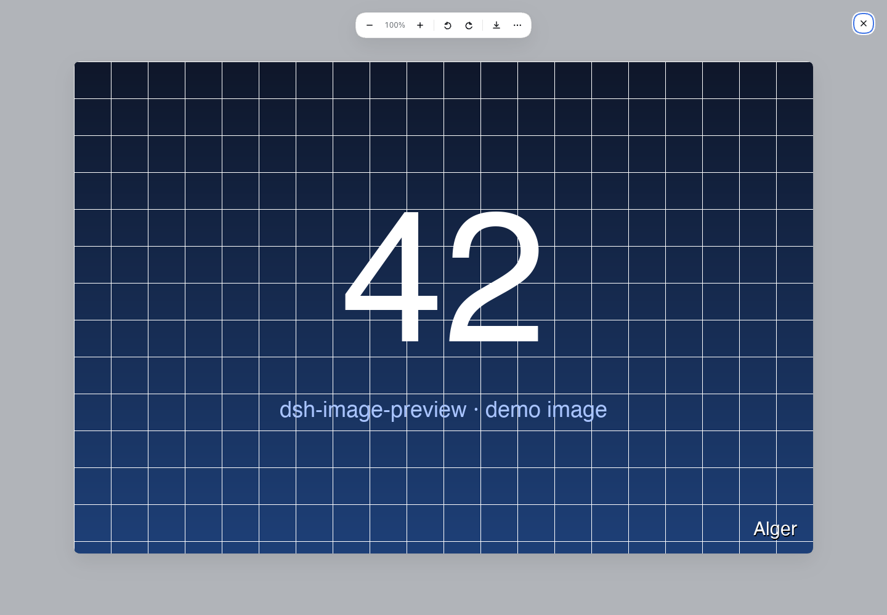
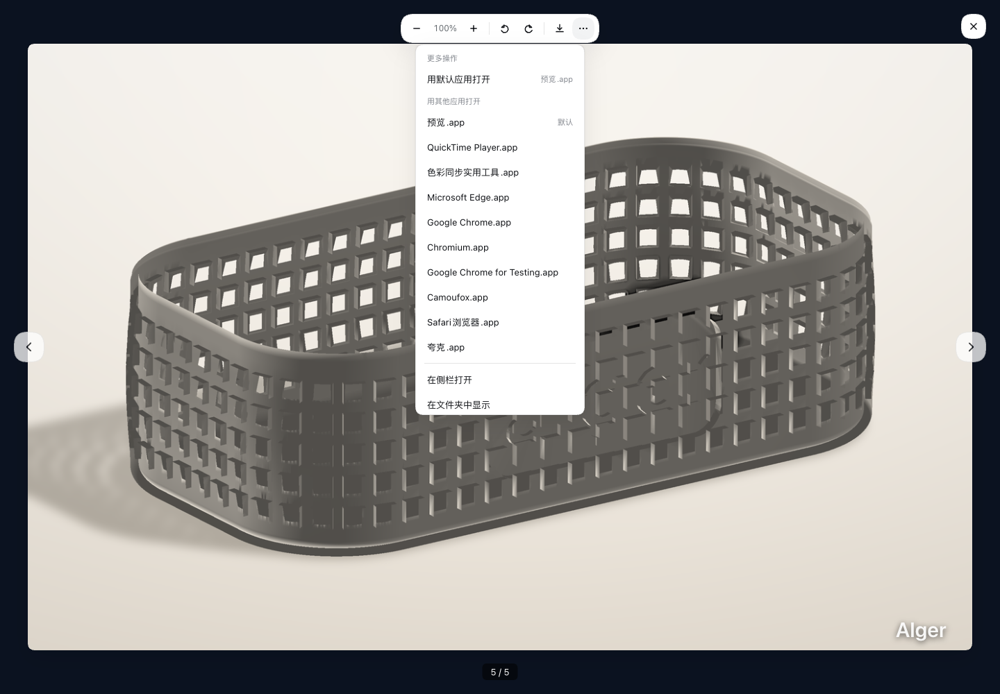

# dsh-image-preview

> [English](./README.md)

**dsh（DeepSeek Harness）会话区图片预览插件。** dsh 0.2.x 已把 `read_image` 渲染成默认折叠的图片卡片，也会把助手最终输出里的图片渲染成官方画廊。本插件同时接管这些位置：`read_image` 工具行**默认显示缩略图**，用户自己发送的图片、最终输出里的图片（包括 `present` 交付卡片里的图片）也走同一套**全屏 Lightbox**，支持跨图导航、缩放、旋转、拖动、下载，以及用默认/关联应用打开、在侧栏打开、在文件夹中显示。

## 功能

| | |
| --- | --- |
| 🖼️ **默认可见缩略图** | `read_image` 结果以约 240px 圆角缩略图展示，不折叠、不撑爆会话流 |
| 🔍 **点击看大图** | 点击缩略图弹出原图预览 — `Esc` / 点击遮罩 / 关闭按钮均可关闭，关闭后焦点还原到触发元素 |
| ↔️ **跨行导航** | 左右按钮 / ← → 键可切换**本会话已加载的全部图片**（计数器显示 `3 / 4`）—— dsh 自带 lightbox 一次只能看单张 |
| 🔎 **缩放 / 旋转 / 拖动** | 工具条含缩小 / 放大 / 左转 / 右转 / 下载。滚轮可缩放，放大后可拖动平移，快捷键 `+` `-` `0` `,` `.`。缩放限制在 25%–800%，切图自动复位 |
| ⬇️ **下载原图** | 按附件原始文件名，经同源 `<a download>` 保存原图（对宿主加载器返回的 `blob:` URL 同样有效） |
| 🔐 **复用官方图片通路** | 图片经 dsh 注入到 slot owner 的会话鉴权加载器 `loadImage` 解析，不再自己手写附件 RPC |
| 🧾 **最终输出图片** | 助手 image block（`conversation.chat.message.images`）和最终回答里的 Markdown 图片也会打开插件 Lightbox |
| 👤 **用户发送的图片** | 用户消息里的图片（`conversation.chat.user.images`）同样接管，点击直接打开插件 Lightbox |
| 📂 **present 图片卡片** | 交付卡片里的图片（如 `preview_hero.png`）整卡点击直接进插件 Lightbox，不再先跳侧栏；STL / Markdown 等非图片卡片保持官方预览 |
| 🧩 **适配 0.2.x 结构** | 只接管整行渲染；官方 `tool.call.images` 子 slot 保持已声明状态，不重复声明 |
| ⏱️ **状态完整** | 运行中（`row.running`）、失败（可点击重试 `image.loadFailed`）、加载中（`image.loading`）都有对应展示 |
| 🌗 **主题自适应** | 颜色全部引用 dsh 主题 token（`--dsw-*`），随 light/dark 主题自动切换 |

### Lightbox 操作

| 操作 | 控件 | 快捷键 |
| --- | --- | --- |
| 放大 / 缩小 | 工具条 `+` / `−`，或滚轮 | `+` / `-` |
| 复位视图 | 点击缩放百分比 | `0` |
| 旋转 | 工具条 ↺ / ↻ | `,` / `.` |
| 拖动平移 | 拖拽（仅放大后） | — |
| 下载 | 工具条 ⤓ | — |
| 更多操作 | 工具条 ⋯ | — |
| 上一张 / 下一张 | 两侧箭头 | `←` / `→` |
| 关闭 | ✕ / 遮罩 / `Esc` | `Esc` |

## 兼容性

针对 **dsh `0.2.1-rc.2`** 构建并验证。浏览器端契约与 `0.1.5-rc.2` 相同；插件仍是纯 client bundle，没有宿主端行为。manifest 声明了 `engines.dsh: >=0.1.5-rc.2 <0.3.0-0`，超出范围时 dsh 会拒绝加载。

**dsh 0.2.x 的变化。** dsh 现在自带 `read_image` 的 toolview、图片卡片，以及由官方 `MessageImages` 画廊填充的 `tool.call.images` 子 slot。官方行**默认折叠**，且自带 lightbox 一次只显示一张图。本插件仍然接管整行，以保留“缩略图默认可见”和额外的 lightbox 功能；它**不声明** `tool.call.images` 子 slot —— 官方条目已经声明过，重复声明会抛 `slot ... is already declared`。

图片位置包括：用户消息里的图片走 `conversation.chat.user.images`（官方 `MessageImages` priority 100，本插件 -1 遮蔽）；助手 image block 走 `conversation.chat.message.images` 这个 single slot：官方 `MessageImages` 的 priority 是 100，本插件用 `priority: -1` 遮蔽它。Markdown 图片（``）由 `MarkdownText` 内部私有的按钮/官方 Lightbox 渲染，不是 slot，因此插件在 document 捕获阶段拦截点击，改用插件自己的 Lightbox。`present` 的交付卡片同样不是 slot：整卡预览按钮的 `title` 是 Host 绝对路径，插件只拦截图片扩展名，改用同一个 Lightbox；STL / Markdown 等卡片仍打开官方侧栏预览。如果宿主没有暴露 ReactDOM render root，拦截会自动放弃，保留官方行为。

`read_image` 只提交 **PNG / JPEG / WebP / GIF**，因此插件能展示的也是这四种；旧文档里关于 SVG / BMP / ICO 的说法已删除。

> **为什么必须用低 priority 接管。** `tool.call.toolview` 是 **keyed** slot，其 registry 会拒绝「同 key 同 priority」的第二次注册：
>
> ```
> keyed slot "tool.call.toolview" already has an entry for key "read_image"
> at priority 0 — register at a different priority to shadow it (lowest renders)
> ```
>
> 因此本插件以 **`priority: -1`** 注册来接管家自带的这一行。少了它，`apply()` 会在浏览器启动阶段抛异常，**一行都渲染不出来** —— 这正是修复前的实际状况。

## 效果预览

**插件 Lightbox** — 真实会话截图：点击图片后进入插件 Lightbox，支持跨图导航、缩放、旋转、拖动和下载：



**交付图片的“更多操作”** — 真实会话截图：工具条右侧的 ⋯ 菜单提供默认应用 / 关联应用 / 在侧栏打开 / 在文件夹中显示：



> 截图：Alger。

## 工作原理

本插件是**纯浏览器端 client 插件**，以 `priority: -1` 注册 `tool.call.toolview` 的 keyed slot（`key: "read_image"`），接管 `read_image` 工具行的渲染：

```
模型执行 read_image
  └─ 工具结果 content: [{ text 信封 }, { type: "image", attachment }]
       └─ tool-call 节点 → tool.call.toolview (key = read_image, priority -1 遮蔽官方行)
            └─ ReadImageRow：小图缩略图 + 点击打开跨行 Lightbox
```

- `sessionId` 与 `t` 由会话级 slot 的 standard kit 注入（`dsh-client-ui-session` / locale seat）。
- `loadImage` 是 dsh 通过 slot owner props 注入的会话鉴权加载器（`MessageImageLoader`，即 `uiConversation.imageUrl(sessionId, attachment)`，按会话缓存）。插件**不再**直接访问 `/api/session.attachment`。
- 附件元数据（`attachmentId` / `mediaType` / `width` / `height`）直接从工具结果块获取。
- Lightbox 视觉与 dsh 自带 `ImageLightbox` 一致（portal 到 `body`、遮罩背景、ESC/遮罩/关闭按钮关闭、焦点还原），但额外提供跨图导航与缩放 / 旋转 / 平移 / 下载。
- 缩放与旋转只是 `` 上的一个 CSS `transform`（不重新编码）；下载把加载器给出的 `blob:` URL 直接交给 `<a download>`，不复制也不重新拉取字节。
- 图片注册表按 `sessionId` 分桶：同时打开多个会话时不会互相串图导航。

最终输出图片：

```
用户消息 → conversation.chat.user.images（single slot，priority -1 遮蔽 MessageImages）
助手内容
  ├─ image block → conversation.chat.message.images（single slot，priority -1 遮蔽 MessageImages）
  │    └─ MessageImagesRow：缩略图 + 点击打开同一个 Lightbox
  ├─ Markdown  → MarkdownText 私有按钮
  │    └─ document 捕获阶段 → 插件 Lightbox（独立 React root）
  └─ present 交付图片 → [data-presented-file] > button[title]（Host 绝对路径）
       └─ document 捕获阶段 → 插件 Lightbox（独立 React root）
```

Lightbox 工具条最右侧的 `⋯` 菜单对带本地路径的图片提供三项操作：用默认应用打开、列出关联应用后用指定应用打开、在侧栏打开、在文件夹中显示。实现走 dsh 的 Session Remote（`openWorkspacePath` / `workspacePathApplications`）和 `sidebarRight.openResource`，路径由 Host 在启动应用前重新校验。

## 安装

dsh 0.2.x 的桌面 App 和 CLI Web 使用不同 profile，按你实际运行的方式选：

- **桌面 App：** `~/.dsh/profiles/desktop`（由 App 保留管理）。
- **CLI Web：** `~/.dsh/profiles/web`。

### 桌面 App

在 App 侧边栏打开**插件**页，从 GitHub 安装 `algerkong/dsh-image-preview`，启用该 bundle 后重启 App。

也可以先**完全退出 App**（运行期间 profile 被锁定），再用 CLI 安装：

```sh
dsh plugin --profile desktop add 'github:algerkong/dsh-image-preview'
```

`add` 只安装依赖，不会自动启用 bundle。请在插件页启用，或把 `"@alger-ai/dsh-image-preview"` 追加到 `~/.dsh/profiles/desktop/package.json` 的 `dsh.profile.bundles`，然后重启 App 并刷新页面。

### CLI Web

```sh
dsh plugin --profile web add 'github:algerkong/dsh-image-preview'
```

然后把包名追加到 `~/.dsh/profiles/web/package.json` 已有的 `dsh.profile.bundles` 数组（保留原有 bundle）：

```json
{
  "dsh": {
    "profile": {
      "bundles": [
        "@deepseek-ai/dsh-base",
        "@deepseek-ai/dsh-web-app",
        "@alger-ai/dsh-image-preview"
      ]
    }
  }
}
```

在 profile 目录执行 `pnpm install`，重启 `dsh web`，最后刷新页面。

### 手动安装

在 profile 的 `package.json` 中加入依赖：

```json
{
  "dependencies": {
    "@alger-ai/dsh-image-preview": "github:algerkong/dsh-image-preview"
  }
}
```

再把 `"@alger-ai/dsh-image-preview"` 加入 `dsh.profile.bundles`，执行 `pnpm install`，重启对应界面。

### 本地开发

直接 link 本地目录：

```sh
cd ~/.dsh/profiles/desktop   # 或 ~/.dsh/profiles/web
pnpm add link:/path/to/dsh-image-preview
```

把 `"@alger-ai/dsh-image-preview"` 加入 `dsh.profile.bundles`，重启并刷新。

## 使用

1. 开始一个会话，让模型对图片文件执行 `read_image`。
2. 工具行默认显示小缩略图（官方行会保持折叠）。
3. 点击缩略图即可在 lightbox 中全屏查看原图。

## 开发

```sh
pnpm install
pnpm test        # node verify.mjs
```

`verify.mjs` 校验三层：`__ModuleLoader__.load` 自注册形状、**keyed slot 接管契约**（复刻 dsh 0.2.1-rc.2 的 keyed + `children` 声明规则；忘了 `priority: -1` 或重复声明 `tool.call.images` 都会失败）、以及一次真实渲染（loadImage 通路、缩略图、lightbox、Esc、多图网格与导航，外加缩放 / 旋转 / 下载工具条）。

自检会依次从仓库 devDependency、`DSH_REACT_PATH`、DSH profile 中寻找 React；找不到会直接报错。只有显式设置 `DSH_VERIFY_ALLOW_SKIP=1` 时才会跳过第三层、只跑前两层。

## 文件结构

```
dsh-image-preview/
├── package.json        # bundle 声明（dsh.bundle.patch / dsh.client platform=web）
├── pnpm-lock.yaml      # devDependency 锁文件（只用于自检，不参与 bundle）
├── cordis.patch.yml    # 注册 client 入口（id: ui-image-preview）
├── lib/
│   ├── index.js        # 宿主端空入口（纯浏览器端插件）
│   └── client.js       # 浏览器端：read_image 行 + 最终输出图片 + 原图预览
└── verify.mjs          # 自检脚本
```

## License

MIT
